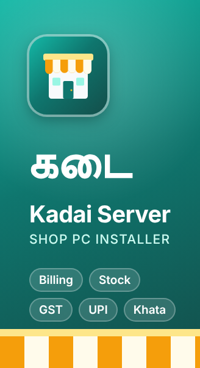

# Kadai Server on Windows (native)

For a shop PC running **Windows 10/11 (64-bit)** or Windows Server 2016+. No Docker needed: the
installer sets up a private Node.js 22 runtime, PostgreSQL 16 and the Windows service
**Kadai Server**. Counter PCs, phones and tablets on the shop network then open
`http://<this-pc>:8080`.

## Install with KadaiSetup.exe (recommended for customers)

Give the shop **`KadaiSetup-<version>-x64.exe`** (an asset of every GitHub release, built by
`.github/workflows/windows-installer.yml`). It is a single, offline file (about 400 MB) that
carries the Kadai server, Node.js 22, PostgreSQL 16 and WinSW, so no internet connection is
needed.



1. Double-click `KadaiSetup-<version>-x64.exe` (Windows asks for administrator rights) and
   pick **English** or **தமிழ்**.
2. **Shop network and backups**: let counter PCs connect (marks the network Private), daily
   backup at 22:45, desktop shortcut.
3. **Choose the screens you need**: tick only the parts of Kadai the shop uses (Stock,
   Purchases & suppliers, Customers & khata, Payments & UPI, Accounts, Reports, Estimates,
   Offers, Barcode labels, WhatsApp & SMS), or use a preset (**Everything**, **Simple shop**,
   **Billing only**). Billing, products and settings are always on. The choice is written to
   `kadai.env` as `KADAI_MODULES` and applied when the owner completes the first-run wizard;
   afterwards it is changed in Kadai under **Settings → Screens**. Hiding a screen only removes
   it from the menu: data and server rules are unchanged (the plan still decides what is
   allowed).
4. **Network port** (8080). Setup checks right away that no other program uses it.
5. Setup installs everything with a step-by-step progress page (checking files, Node.js, the
   database, the service, starting Kadai) and waits until Kadai answers. The finish page lists
   the addresses for counter PCs and phones (PC name and LAN IP, e.g. `http://192.168.1.10:8080`);
   **Open Kadai now** opens Kadai in its own window (Microsoft Edge app mode, as the shop user,
   not as administrator). Then the setup wizard: shop name, GSTIN, owner login; upload the
   licence in Settings → System.

The same `.exe` also **upgrades** an older installation (pre-upgrade backup, switch, health
check, previous version kept for `install.ps1 -Rollback`), **repairs** the same version, and
**reinstalls** after an uninstall (it reuses `C:\ProgramData\Kadai\kadai.env` and the
database). It **refuses to downgrade** a newer installation (migrations are forward-only).
**Uninstall** from Settings → Apps → Kadai Server: the service, firewall rule, shortcuts and
program files go; data, backups and the PostgreSQL database are kept. If something fails, Setup
shows the reason and offers to open the log in Notepad; running Setup again continues where it
stopped.

Silent install for IT staff:

```powershell
KadaiSetup-<version>-x64.exe /VERYSILENT /SUPPRESSMSGBOXES /NORESTART /LOG=C:\kadai-setup.log `
  /PORT=8080 /TASKS="network,backup,desktopicon" /MODULES=inventory,customers,reports /LANG=tamil
# PostgreSQL 16 already on the PC: /PGPASSWORDFILE=C:\pg.txt (preferred; /PGPASSWORD=... is
# written into the /LOG file by Inno Setup)
```

`/MODULES` takes `all` (default), `none` (billing only) or a comma list of `inventory`,
`purchases`, `customers`, `payments`, `accounts`, `reports`, `estimates`, `promotions`,
`labels`, `notifications`. Exit code 0 means installed and healthy; 1 means refused (a newer
version is installed); 7 means the installation failed (details in
`C:\ProgramData\Kadai\logs\install-*.log`).

**Building the .exe** (Windows, from the repository root, after `pnpm build` and
`.github/scripts/bundle.sh <version> win-x64`; needs Inno Setup 6):

```powershell
powershell -ExecutionPolicy Bypass -File deploy\onprem\windows\installer\build-installer.ps1 `
  -Version 1.4.0 -Bundle dist\release\kadai-server-1.4.0-win-x64.zip
```

It downloads and verifies the offline dependencies (Node.js SHA-256, PostgreSQL Authenticode,
WinSW pinned SHA-256) and writes `dist\release\KadaiSetup-1.4.0-x64.exe`. **Sign it before
shipping**: with a code-signing certificate in `KADAI_SIGN_PFX_BASE64` / `KADAI_SIGN_PFX_PASS`
(environment, or repository secrets for the workflow) setup and uninstaller are signed;
unsigned, Windows SmartScreen warns the customer. `deploy/tests/windows/installer-e2e.ps1`
tests install (with chosen screens) → busy port refused → repair → downgrade refused →
uninstall → reinstall on a throw-away Windows machine (CI does this on every build).

Files: `installer/kadai-setup.iss` (Inno Setup script), `installer/lang/*.isl` (English and
Tamil texts, UTF-8 with BOM), `installer/assets/` (wizard images and icon, rendered from the
Kadai logo by `render-assets.mjs`), `installer/run-install.ps1` (unattended wrapper around
`install.ps1` with log, exit code and address summary), `installer/README.txt` (guide installed
for the shop).

## Install with PowerShell (manual / scripted)

1. Unpack `kadai-onprem-<version>.zip` (for example to `C:\KadaiSetup`). Put
   `kadai-server-<version>-win-x64.zip` and `SHA256SUMS` from the same release next to it (the
   installer downloads them itself when the PC is online).
2. Start **PowerShell as administrator** and run:

   ```powershell
   cd C:\KadaiSetup\kadai-onprem-<version>
   powershell -ExecutionPolicy Bypass -File .\windows\install.ps1 -SetNetworkPrivate -BackupTask
   ```

3. Open the **Kadai** shortcut on the desktop (or `http://localhost:8080`) and complete the setup
   wizard: shop name, GSTIN, owner login. Upload the license in Settings → System.

What the installer does:

| Step          | Details                                                                                                                                                                                     |
| ------------- | ------------------------------------------------------------------------------------------------------------------------------------------------------------------------------------------- |
| Node.js 22    | private copy in `C:\Program Files\Kadai\node` (checksum verified); does not touch other Node.js installs                                                                                    |
| PostgreSQL 16 | EDB installer, unattended (signature verified), service `postgresql-x64-16`, port 5432 on this PC only; superuser password saved in `C:\ProgramData\Kadai\secrets` (administrators only)    |
| Database      | roles `kadai_owner` / `kadai_app`, database `kadai`, extensions `pg_trgm`, `citext`                                                                                                         |
| Application   | `C:\Program Files\Kadai\app` (read-only for the service)                                                                                                                                    |
| Configuration | `C:\ProgramData\Kadai\kadai.env` — generated secrets; readable by SYSTEM, Administrators and the service only. **Copy it to a USB drive and keep it safe** (needed to restore on a new PC). |
| Service       | **Kadai Server** (WinSW), automatic (delayed) start after PostgreSQL, runs as `LocalService`, restarts on failure; migrations run on every start                                            |
| Data          | `C:\ProgramData\Kadai\data` (files, backups), logs in `C:\ProgramData\Kadai\logs`                                                                                                           |
| Network       | firewall rule "Kadai Server (TCP 8080, local network)" for Private/Domain networks and the local subnet only                                                                                |
| Extras        | desktop shortcut; with `-BackupTask` a daily backup at 22:45 (Task Scheduler "Kadai Backup")                                                                                                |

Options: `-Port 9090`, `-PublicUrl http://billing-pc:8080`, `-InstallDir`, `-DataRoot`,
`-SkipFirewall`, `-NoShortcut`, `-Yes`. Offline installation: download the files on another PC
and pass `-NodeZip node-v22.x.y-win-x64.zip -PostgresInstaller postgresql-16.x-1-windows-x64.exe
-WinSWExe WinSW-x64.exe -BundlePath kadai-server-<version>-win-x64.zip`. If PostgreSQL 16 is
already installed, the installer asks for its `postgres` password (or pass
`-PostgresSuperPassword (Read-Host -AsSecureString)`).

> **"Public" network?** Windows marks new networks as Public and then blocks counter PCs.
> `-SetNetworkPrivate` switches the shop network to Private; or Settings → Network & Internet →
> (your network) → Network profile type → Private.

## Daily operation

| Task                  | Command (PowerShell as administrator, in `C:\Program Files\Kadai\scripts`)         |
| --------------------- | ---------------------------------------------------------------------------------- |
| Status / restart      | `Get-Service kadai` · `Restart-Service kadai` (or services.msc → Kadai Server)     |
| Logs                  | `Get-Content C:\ProgramData\Kadai\logs\kadai-service.out.log -Tail 100 -Wait`      |
| Backup now            | `.\backup.ps1` (or `-Dest E:\KadaiBackups -Label before-gst-change`)               |
| Restore               | `.\restore.ps1 -File C:\ProgramData\Kadai\data\backups\<file>.dump`                |
| Upgrade               | `.\install.ps1 -Upgrade -BundlePath <path>\kadai-server-<new version>-win-x64.zip` |
| Undo the last upgrade | `.\install.ps1 -Rollback`                                                          |
| Reinstall (keep data) | `.\install.ps1 -Reinstall -BundlePath <path>\kadai-server-<version>-win-x64.zip`   |
| Remove (keeps data)   | `.\install.ps1 -Uninstall`                                                         |

Backups: Kadai makes its own daily backup; `-BackupTask` adds a second one. Put
`KADAI_BACKUP_COPY_TO=E:\KadaiBackups` (a USB drive or network share) into `kadai.env` so every
backup is also copied off the PC. Retention: `KADAI_BACKUP_RETENTION_DAYS` (30) /
`KADAI_BACKUP_KEEP_MIN` (7).

Upgrades take a pre-upgrade backup, switch the application folder (the previous one is kept as
`app.prev`), start the service and wait until Kadai is ready; `-Rollback` puts back the previous
version and restores that backup.

More: `docs/DEPLOYMENT.md` (HTTPS for installable POS on counter PCs, payments, SMS/WhatsApp)
and `docs/RUNBOOK.md` (what to do when something goes wrong).
